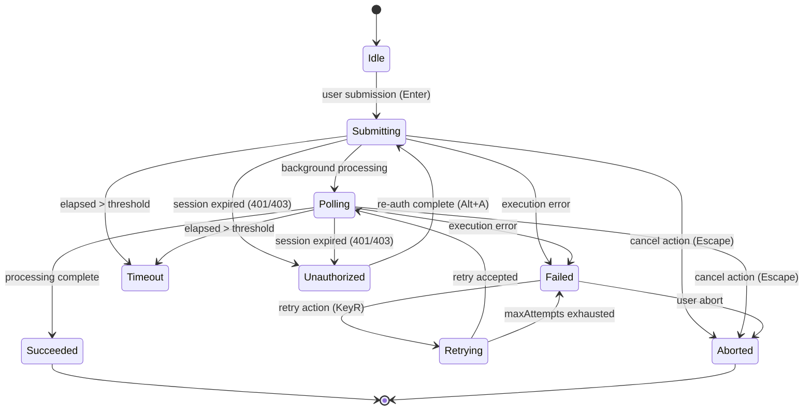

# Accessibility Architecture: Async Error Recovery & Focus Management

This document defines the accessibility guarantees, state transitions, ARIA announcement rules, keyboard shortcuts, and rollback behaviors for asynchronous operations across Trellis API (Auth, Portfolio, DeFi, Notifications, and Observability).

## State Machine & Transitions

Async operations transition through the following lifecycle phases:

## ARIA Live Regions & Focus Management Rules

| Phase | Politeness | Interrupt | Focus Target | Keyboard Shortcuts | Notes |
| :--- | :--- | :--- | :--- | :--- | :--- |
| **Submitting** | `polite` | `false` | `pendingFocusTarget` | `Escape` to abort | Focus is trapped inside the pending container. |
| **Polling** | `polite` | `false` | `pendingFocusTarget` | `Escape` to abort | Progress updates announced at discrete intervals. |
| **Succeeded** | `polite` | `false` | `completionFocusTarget` | `Enter` to confirm | Informs user of successful completion. |
| **Failed** | `assertive` | `true` | `failureFocusTarget` | `KeyR` to retry, `Escape` to abort | Immediately shifts focus to error alert / summary with actionable recovery steps. |
| **Retrying** | `polite` | `false` | `pendingFocusTarget` | `Escape` to abort | Announces `attempt N of M` with exponential backoff delay. |
| **Retry Exhausted** | `assertive` | `true` | `failureFocusTarget` | `Escape` to abort | Signals final failure and abort/review instructions. |
| **Unauthorized** | `assertive` | `true` | `authFocusTarget` | `Alt+A` to re-authenticate | Focus redirects to re-authentication modal; `returnFocusTargetAfterAuth` preserves original focus position. |
| **Timeout** | `assertive` | `true` | `failureFocusTarget` | `KeyR` to retry, `Escape` to abort | Announces timeout error and provides retry/abort controls. |
| **Aborted** | `assertive` | `true` | `abortFocusTarget` | — | Confirms rollback of pending state if operation is `rollbackSafe`. |

## Recovery and Rollback Invariants

1. **Rollback Safety**:
   - Operations marked `rollbackOnAbort: true` or `rollbackSafe: true` (e.g. uncommitted portfolio rebalances, staged DEX orders, unsent notifications) automatically trigger compensating reversals on abort.
   - Irreversible actions (e.g. on-chain submitted Soroban transactions) emit explicit guidance that manual dispute or support contact is required.
2. **No stale error state**:
   - Re-entering `Submitting` or `Retrying` clears `errorRecovery`, so assistive technology never reads the previous failure's summary and recovery steps while a new attempt is in flight. `Succeeded` and `resolveRecovery()` clear it as before.
3. **Focus Containment & Restoration**:
   - Focus must never reset to `document.body` on error or after re-authentication.
   - When `resolveRecovery()` is invoked, focus is returned to `returnFocusTargetAfterAuth` or the original trigger field.

## Contract Preservation & Migration

The `AsyncErrorRecoveryContract` is built on top of `AsyncStatusAccessibilityContract` and `ErrorRecoveryAccessibilityContract`. No existing schemas or API response contracts are broken.
